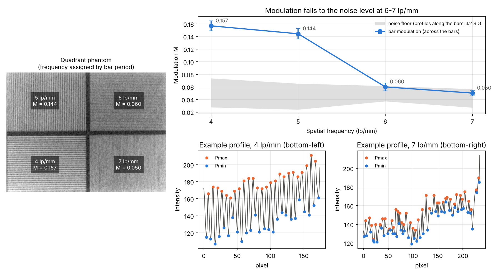
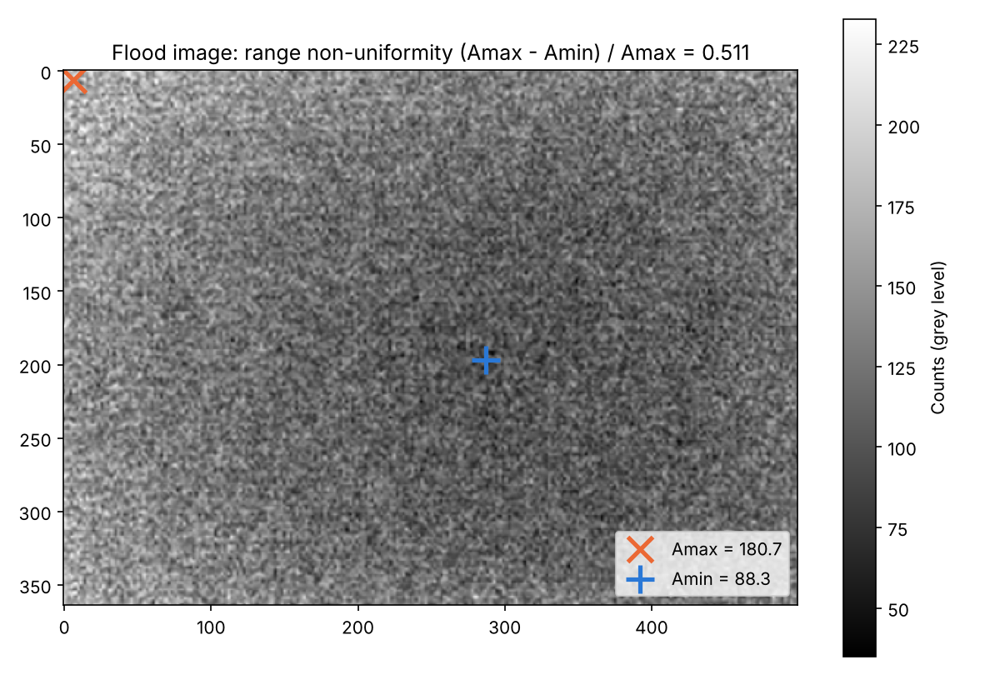

# Gamma-camera quality control: bar-phantom modulation and field uniformity

Two standard quality-control measurements of a gamma camera (nuclear medicine), computed in Python
from the phantom images in this repository:

- **A. Spatial resolution.** Modulation of a four-quadrant bar phantom with 4, 5, 6 and 7 line pairs
  per mm.
- **B. Field uniformity.** How much a flat-field (flood) image varies across the detector.

## A. Bar-phantom modulation

For each quadrant the script detects the bar orientation and period with a Fourier transform. It
then takes **every** profile perpendicular to the bars (167–233 profiles per quadrant), not a single
line, and computes

M = (P̄max − P̄min) / (P̄max + P̄min)

from the mean of each profile's maxima and minima. A **noise floor** is measured with the same
formula on profiles running *along* the bars, where there is no bar signal.

| lp/mm | Quadrant | Bar period (px) | Modulation M (mean ± SD) | Noise floor |
|---|---|---|---|---|
| 4 | bottom-left | 6.70 | 0.157 ± 0.008 | 0.051 |
| 5 | top-left | 5.67 | 0.144 ± 0.008 | 0.045 |
| 6 | top-right | 4.83 | 0.060 ± 0.006 | 0.049 |
| 7 | bottom-right | 4.41 | 0.050 ± 0.005 | 0.042 |



- **4–5 lp/mm are resolved.** M is about three times the noise floor.
- **6–7 lp/mm are essentially not resolved.** M is within the noise level, so these bar patterns
  are at or beyond the camera's resolution limit in this image.
- **Frequency assignment is an inference.** The task description does not say which quadrant holds
  which frequency, so frequencies are assigned by measured bar period (finest bars = 7 lp/mm). The
  order is clear, but the periods do not scale exactly as 1/f: the implied pixel size ranges from
  0.032 to 0.037 mm. The assignment should be checked against the phantom's documentation.

## B. Field uniformity

A(p) is the mean of the flood image in a 13 × 13 window around each pixel.

| Measure | Value |
|---|---|
| A max | 180.7 (row 6, column 6) |
| A min | 88.3 (row 197, column 287) |
| Range non-uniformity (Amax − Amin) / Amax | **0.511** |
| Mean relative deviation, mean of \|A − Ī\| / Ī | 0.102 |



**Border handling.** Only pixels whose whole 13 × 13 window lies inside the image are used. If border
pixels are included, the filter averages mirrored pixels at the corner: Amax becomes 200.6 at pixel
(0, 0) and the non-uniformity is overstated as 0.560.

The flood image is brightest near the top-left corner and darkest near the centre, which gives the
large range non-uniformity.

## Run it

```bash
pip install -r requirements.txt
python gamma_camera_qc.py      # prints the tables, writes results/results.json and figures/
python -m pytest -q tests      # synthetic bar patterns with known period and modulation
```

## Notes

- **Modulation vs. MTF.** M is the modulation measured at each bar frequency. A true MTF value would
  also divide by the modulation of the object itself, which is not known for this phantom image.
- **No standard uniformity regions.** NEMA uniformity tests use defined useful and central fields of
  view (UFOV / CFOV) and prescribed smoothing. This analysis follows the course task (13 × 13 mean
  filter over the whole image), so the values are not directly comparable to NEMA figures.
- **Course origin.** Medical Imaging Systems course, University of Thessaly.
